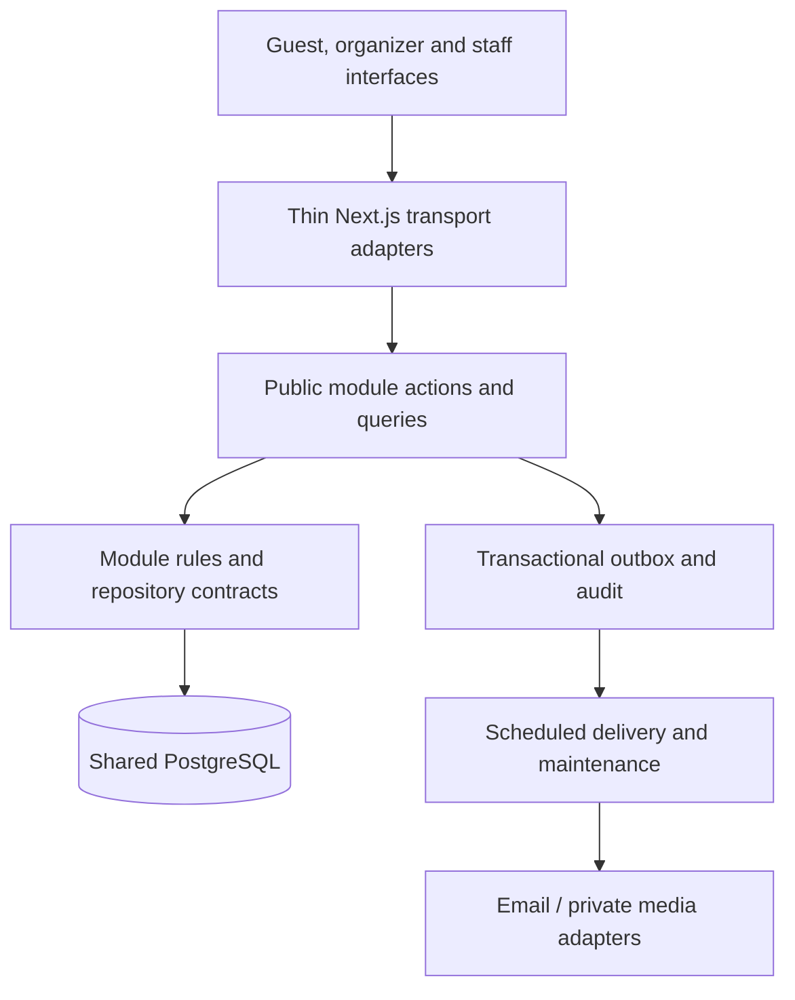

# MOMENTUS implementation plan

**Prepared:** 4 November 2026, Asia/Manila.  
**Status:** Q1–Q75 accepted with U2–U12 refinements recorded. The local app includes development-only synthetic client/event management and RSVP previews. Existing database event modes, private invitation/RSVP RPCs, NFC registry, and Designer Studio draft paths remain unverified against PostgreSQL. Migration `0006_solid_hydra.sql` is not applied; `.env` identifies Supabase project `zktyesiawrwfybcllnkr`, but does not establish isolated synthetic-development ownership. Remote migration state is unknown; Supabase CLI, `psql`, and Docker are unavailable. Nine isolated local-demo Playwright scenarios pass across Designer Studio, onboarding/RSVP preview, companion responses, local approval/history, conditional field validation, and stage draft keys. Database roundtrip, tenant isolation, and concurrency remain unverified. Publication, public rendering, media, real guest bindings, email delivery, staff check-in/redemption, and physical-device validation remain outstanding. Production will self-host Next.js and Supabase PostgreSQL/Auth/Storage; platform/recovery choices remain deferred until the local workflow is ready to deploy.

The unchanged [PDF](MOMENTUS_Product_Specification.pdf) is the product baseline. The [decision record](DECISIONS.md) contains user-approved refinements. [Acceptance criteria](ACCEPTANCE.md) define the evidence required for completion. [References](REFERENCES.md) distinguish researched facts from engineering proposals.

## 1. Product and launch boundary

Build a multi-tenant event platform for Philippine weddings and debuts. An organization can own several events; an independent couple can own a one-event organization. One account may belong to several organizations with different permissions. U2 adds a MOMENTUS platform admin console that lists clients and their event microsites, with audited site configuration controls scoped separately from access to guests' personal event data.

Deliver a complete online pilot: three event themes and microsites; private invitations; guest import and RSVP; automated confirmation; tables/seats; stable NFC links with event-wide RSVP, Meal & Booth, and Post-event Album modes; physical-card registry; NFC/QR staff operations; individual meal/booth claims; moderated guest booth media submissions; audited exceptions; dashboards/exports; curated memories gallery; automated memories notification; privacy and retention administration.

Manual onboarding, commercial arrangements, card procurement/printing/programming, and privacy-request review are part of pilot operations. Subscription checkout, campaigns/reminders/SMS/WhatsApp integrations, native iPhone NFC scanning, offline synchronization, cryptographic anti-cloning, visual floor plans, automatic seating optimization, guestbook, advanced zones/session ticketing, and enterprise integrations are later work. U4 adds moderated guest photo/video contributions at event booths and an admin-managed physical card registry. U6/U7 supersede the original freeform-builder deferral; see the Designer Studio delivery slice and decision record. This scope update does not mean publishing or safe public rendering is already complete.

Concurrent online devices and configured entrance/meal/booth stations are included. The later roadmap's advanced station orchestration is not required to provide the accepted MVP station workflow.

## 2. Local-first development

### First local milestone

The project contains the Next.js App Router/TypeScript app, a root pnpm lockfile, feature modules, and Supabase SSR adapters. The local server is launched with `pnpm dev`. The ignored `.env` is configured for the user-provided Supabase project; no credential is stored in the repository.

Use pnpm for install, scripts and the lockfile. The normal inner loop is:

```powershell
pnpm install
pnpm dev
```

Open `http://localhost:3000` in the Windows development browser. Keep one root `pnpm-lock.yaml`; do not mix npm/yarn lockfiles. Use the installed Node/pnpm tools as a starting point, then pin supported versions compatible with the selected Next release.

Connect the local Next server to a **managed Supabase Cloud development project** with synthetic/test records. Set the URL and publishable key in ignored `.env`; Drizzle Kit reads `DATABASE_URL` from the same file for reviewed migrations. Do not commit credentials or print keys. Never use production accounts, cards, messages, database or media in local work. Auth calls work with the publishable key; organizer and RSVP persistence needs the schema migration applied.

Build and review a small, representative local slice first: organization sign-in/workspace, one sample event, the first theme preview, and invitation/RSVP outline. This confirms the local boot path and design direction before expanding the full feature set. Add local scripts for build/typecheck/lint and the meaningful tests agreed in Q71 as each feature arrives. Do not install or configure a local Supabase stack unless the user requests it; Docker is not installed in the current Windows environment.

### Early physical NFC test path — Q75 accepted

Ordinary local Next development uses `http://localhost`. Web NFC for staff needs an HTTPS secure context in Android Chrome, a user gesture, permission, and a visible/unlocked page. On a phone, `localhost` refers to the phone itself; a Windows PC's plain `http://192.168...` LAN address is not a secure origin. Making Next reachable on the LAN alone does not enable Web NFC.

Before building all staff workflows, test a tagged synthetic invitation on the intended Android phone through a trusted HTTPS preview/tunnel that points to the local app, or another tested secure local-phone origin. Keep this route limited to synthetic data. QR and desktop/local UI development remain local. Decide the exact preview/certificate path when the first NFC prototype is ready; never program real cards with a temporary preview URL.

Q75 approves temporary trusted HTTPS access for early physical staff-NFC tests. Use synthetic data and disposable test tags only. Continue ordinary development on localhost; never program real cards with a temporary URL. Validate the exact device on the final self-hosted HTTPS domain before pilot.

### Production deployment questions — deferred Q76

Production is confirmed as a self-hosted Next.js + Supabase Postgres/Auth/Storage stack. The local phase does not require the production server's hostname, CPU/RAM/storage, reverse proxy, backup appliance, or orchestration platform. Identify those after the local workflow works and before the self-host deployment/restore milestone. Do not redirect this local implementation to Vercel or point it at a production database.

## 3. Main model and user journeys

### Private invitation and card

**One NFC card → one private invitation → one primary guest + N configured companions.** N may be zero. The card is permanently bound to that invitation after issuance and remains a keepsake. Exactly one physical card is active; replacement invalidates the old card credential. Revoking an invitation invalidates all its guest access and operational passes. Replacing only its card does not silently cancel the invitation.

The tag contains an opaque HTTPS URL, not personal information. Its printed QR uses the same invitation URL. The token is carried in the URL fragment (`/invite#<token>`), so browsers do not send it in the initial request URL or ordinary server access logs; the guest page submits it in a server-action request body. The server then resolves the event's current NFC mode, so the physical URL stays stable when the admin switches RSVP, Meal & Booth, and Post-event Album. NFC/QR content is still a transferable bearer credential: copying or forwarding it is possible. Server-side checks prevent duplicate consumption, not impersonation or first use of a copied pass. This risk is accepted for the MVP.

### Before the event

1. An organizer creates an event, capacity, timezone, RSVP deadline, content draft, stations, and meal/booth eligibility settings.
2. Organizer creates/imports private invitations, labels recipients where known, and sets companion allowances. Known attendee/contact details can be prefilled; recipients can supply names through RSVP.
3. Issuance reserves `1 + companion allowance` places. Draft invitations do not reserve places. Issuance fails if the total reservations would exceed event capacity.
4. Organizer writes the URL to a blank test NFC tag from a supported HTTPS Android browser or an external tool, prints its QR fallback, and distributes the card or manually shares the link. The in-app writer refuses to overwrite a non-empty tag.
5. The guest taps and views the published invitation immediately. Submitting RSVP requires named people and a primary email; extra attendee emails are optional. The number of people cannot exceed the allowance.
6. Each person is attending, declined, or undecided. Named companions may attend without the primary guest. Children are managed by a guardian; no child email or full birth date is required.
7. RSVP commit creates the relevant records, permission receipts, individual digital passes, audit entries, and email-outbox work. Initial submission is accepted immediately; receiving an email does not establish verified personal identity.
8. Confirmation email includes the submitted response, individual pass links/QRs, and a private management link. Send to the primary contact and explicitly supplied additional recipients as appropriate to their scope.
9. After the initial response, names/attendance/contact edits need the emailed management credential and remain open until the deadline. A mistyped or inaccessible primary email is resolved through a manager-assisted process; possession of the physical card alone does not reopen editing.
10. Keep the full issued allowance reserved until the deadline, even when the current response uses fewer places. At cutoff, release unused places and preserve places for attending guests. Managers handle subsequent changes within capacity. Deadline enforcement must work even when a scheduled job is late.
11. Organizers assign tables and optional seat numbers. Prevent duplicate seat assignment and show/enforce table-capacity constraints through an authorized correction workflow.

### Event day

1. Staff sign in with individual accounts and select an assigned event/station.
2. On supported Android Chrome devices, staff explicitly enable NFC scanning and permission. The scanning page must stay visible and the device awake/unlocked. QR camera scanning and authorized manual lookup are available.
3. NFC card scan resolves the private invitation and shows the relevant named people. An individual QR resolves only its attendee. Parse only expected platform URLs/tokens; never automatically navigate to or fetch an arbitrary scanned URL.
4. Validate event, credential status, invitation, attendee RSVP, staff role, station, and permitted operation. Show names, eligibility, relevant table information, and useful status; sensitive notes appear only where authorized.
5. Staff select the people actually arriving or being served and explicitly confirm. Revalidate inside the mutation transaction. Never check in or redeem the whole group merely because its card was tapped.
6. Record first arrival per attendee. Repeated scans show already checked in and permit physical re-entry without another first-arrival record. MVP attendance counts are cumulative arrivals, not current occupancy.
7. Confirmed attending guests have independently assigned one-time meal and booth entitlements. A meal claim does not consume another person's meal or unrelated booth claims. Concurrent devices cannot consume the same remaining claim twice.
8. Managers can resolve RSVP exceptions, register walk-ins within capacity, change entitlements, and reverse mistaken operations. Require a reason and immutable history. Reversing check-in does not silently reverse independent meal/booth claims; resolve each explicitly.
9. On network failure, show a failed/unconfirmed operation rather than success. Use the documented manual exception log and later manager reconciliation. Do not queue invisible offline claims or describe paper fallback as synchronized offline support.

### Memories and expiry

1. Hosts upload curated photos and add external video links. Guests may also submit booth photos/videos during the event. All gallery and guest-submitted uploads remain private; guest submissions require applicable permission/rights and host approval before publication.
2. Organizer explicitly publishes memories. The same NFC invitation and appropriate digital links display the memories experience without changing the physical tag. Event-wide NFC mode controls the guest destination: RSVP before the event, Meal & Booth during operations, or Post-event Album after memories publication.
3. Queue one logical memories notice per eligible contact/publication. Include active contacts who declined attendance if they opted in. Respect post-event notice opt-out and revoked invitations.
4. Downloads default off; host may enable them. This setting controls the provided feature, not screenshots or copying.
5. Guest access ends 12 calendar months after the event, unless an extension is explicitly arranged. Warn in advance; retain a 30-day host export/extension window after expiry.
6. Then purge gallery objects and identifiable event records through tracked deletion work, subject to a documented valid exception. Retain only genuinely anonymized aggregate statistics. Revoke access when expiry/deletion takes effect; verify physical deletion and backup expiry separately.

### Lifecycle changes

Normal states are draft → published → live → memories → archived, with authorized explicit transitions. Dates can prompt action but do not independently publish or switch modes. Cancellation is available before live and blocks check-in/redemption while retaining history under the retention policy.

Before-live rescheduling retains URLs/history, establishes a new deadline, and requests RSVP reconfirmation. Preflight capacity and reservations, including any previously released/reallocated places, before committing. A date change cannot silently overbook or restore withdrawn companion allowance. Managers review and confirm update notifications. Changes after live require a separately documented correction process rather than silently resetting attendance or claims.

## 4. Roles and credentials

| Actor | Scope and capabilities |
| --- | --- |
| Organization owner/admin | Organization administration, member/event assignment, organization events, support-grant approval; mandatory verified-account MFA. |
| Event manager / couple | Assigned event content, invitations, guest/RSVP/seating management, station assignment, publishing, reports, exceptions/reversals; mandatory MFA. Cannot grant organization-wide privileges. |
| Station staff | Assigned event and station operations, minimal lookup/status data; no guest creation, broad exports, role changes, or overrides. Individual account; MFA optional. |
| Primary invitation contact | Guest invitation view and initial RSVP; emailed management link controls subsequent group edits until deadline. |
| Individual attendee | Scoped digital pass and permitted event/memories access. An individual admission pass does not grant management of companions. |
| Platform operations | Tenant onboarding, suspension and operational diagnostics. Customer content access requires a customer-approved, temporary audited support grant. |
| System jobs | Narrow maintenance/delivery capabilities; not an interactive support backdoor. |

Guest labels such as VIP/family/vendor are separate from authenticated staff roles. A guest labelled staff does not thereby receive staff-account permissions.

Use separate invitation/card, attendee-pass, emailed-management, staff-session, and support-grant credentials. Scope each by intended operation, invitation/person, organization/event, expiry, and revocation state. Use cryptographically random opaque secrets and indexed hashes for lookup. If recovering a URL is needed for approved export/delivery, protect that secret material with server-only encryption and limited access; do not log plaintext tokens or put personal data in tag URLs. The local first-slice migrations are under `drizzle/`; the development database still needs a reachable PostgreSQL URL before `pnpm db:migrate` can be applied.

Use Supabase Auth during development for email/password, verification, recovery, and authenticator-app TOTP. Production Auth deployment remains to be confirmed under U1. Enforce MFA assurance and live role/resource authorization on the server, not only on screens. Guest capability resolution is separate from authenticated staff sessions. Rate-limit public token, RSVP, lookup, login, and resend endpoints.

## 5. Modular monolith and action pattern



Use one Next.js App Router application with TypeScript, pnpm, Tailwind and shadcn/ui. Pin supported package/runtime versions when scaffolding; the locally installed Node patch is not automatically the production runtime choice.

| Module | Owns |
| --- | --- |
| `identity` | Auth integration, verification/recovery, sessions and MFA policy enforcement. |
| `organizations` | Tenant records, memberships, organization roles and workspace selection. |
| `events` | Event configuration, timezone, lifecycle, active guest NFC mode, capacity/reservation policy, reschedule/cancel. |
| `microsites` | Themes, structured content, previews, draft/published versions. |
| `invitations` | Private invitations, allowances, contact recipients, credential/card inventory, assignment/replacement/revocation. |
| `guests` | Named primary/companion attendees, categories and invitation relationships. |
| `rsvp` | Per-person responses, configured selections/notes, permission receipts, revisions and deadlines. |
| `seating` | Tables, optional seats and assignments. |
| `stations` | Station configuration, operation type and staff assignments. |
| `check-in` | First-arrival records, re-entry status and audited corrections. |
| `redemptions` | Meal/booth entitlements, atomic claims and reversals. |
| `memories` | Host and guest media objects/metadata, private review, quota, gallery publication, downloads, hosting lifecycle. |
| `notifications` | Templates, recipients, outbox, retry/idempotency, provider delivery events and notice opt-out. |
| `audit` | Structured history and reason records with redaction/retention. |
| `reporting` | Authorized operational counts, charts and CSV exports through declared read contracts. |
| `platform` | Manual onboarding, scoped support, privacy-request tools and cross-module maintenance orchestration. |

Planned layout:

```text
src/
  app/                         # routes, layouts, thin Server Actions/Route Handlers
  modules/<feature>/
    actions/                   # named async application use cases
    queries/                   # authorized read use cases
    domain/                    # rules and domain types
    infrastructure/            # module repositories/provider adapters
    ui/                        # feature-owned components
    public.ts                  # supported contracts/types
    server.ts                  # guarded server entry point
  shared/
    db/                        # Drizzle connection, migrations/UoW plumbing
    auth/                      # trusted context primitives
    infrastructure/            # low-level email/storage/job/observability clients
    ui/                        # reusable design-system primitives
```

An action such as `issueInvitation(input, context)` validates input; verifies the actor/tenant/event; calls module rules; coordinates its transaction through a unit-of-work contract; writes the business change, audit entry, and outbox work; and returns a typed result. Compose dependencies at the module boundary. Keep Next.js request/cookie/cache APIs in adapters, not domain rules. Expected errors have stable typed codes; redact unexpected failure details.

The server constructs trusted context from a verified session or resolved guest capability. An organization ID sent by a client is a resource selector, not proof of membership. Modules may call declared public contracts; do not import another module's private tables/repositories or issue unowned writes. Cross-module workflows can share the same database transaction. Ordinary reads use public queries, not serialized Server Actions.

## 6. Data and correctness

The schema will include organizations/memberships; events/event access and active guest mode; stations/assignments; content versions; invitations/contacts/credentials; invitation-bound NFC card inventory/assignments; attendees; RSVP submissions and permission receipts; tables/seats/assignments; entitlements; check-ins; redemption/reversal ledger; private guest media submissions/review/publications; notification outbox/provider events; audit events; support grants; and privacy/deletion work records. Supabase owns production authentication credentials; local demo sign-in remains isolated to synthetic UI fixtures.

Every tenant-owned row carries organization scope and event scope where relevant. Use composite foreign keys/constraints to prevent cross-tenant or cross-event references, database authorization/RLS with appropriate least-privilege roles, and explicit application authorization. Privileged maintenance/token-resolution capabilities must be narrow and server-only. Test actual database roles/policies; a bypass-RLS administrator connection is not evidence of tenant protection.

Key invariants:

- Serialized/locked capacity updates prevent concurrent invitation issuance or manager changes from exceeding capacity.
- One primary attendee slot per invitation; named companions never exceed allowance. No automatic identity merge by matching name/email.
- Check-in, entitlement consumption, reversal, and idempotency constraints live in PostgreSQL transactions and unique constraints, not just UI flags.
- Replayed requests return the original logical result. Reusing an idempotency key for different input is rejected.
- Each confirmed mutation validates the current credential, event state, role/station, RSVP and remaining allowance again; scan previews are not authority.
- Never send email before the business transaction commits. Duplicate job/provider callbacks do not produce duplicate logical messages or state transitions.
- Personalized pages/responses must not enter shared caches without correct isolation. Private media needs authorized short-lived access; never expose storage service credentials in the browser.
- RSVP, access expiry and entitlement rules are evaluated against current server time; late housekeeping jobs cannot extend access.
- Reversals preserve original records and actors/reasons. Deletion is tracked rather than falsely marked complete before storage/backup obligations finish.

## 7. Content, import and dashboards

The initial Q14 structured-theme direction is refined by U6/U7: keep the GrapesJS Core Designer Studio and its twelve current original starter templates, and move the editor onto real event records. Persist complete GrapesJS project JSON in event-scoped drafts with server authorization and optimistic revisions. Continue to keep presentation separate from event/RSVP business logic. Publishing must use immutable snapshots and a safe renderer; do not expose arbitrary scripts or private guest data. Import, uploads, guest-specific bindings, and media lifecycle remain separate scope that needs explicit implementation and verification.

### Designer Studio delivery slice (U6/U7)

1. Open Designer Studio from the authenticated event workspace after verified email and MFA.
2. Create or load one event-owned microsite draft and save complete GrapesJS project JSON through an authorized server action/database RPC. Debounced saves carry a draft revision and reject stale writes rather than overwrite another editor.
3. Keep the 12 existing templates as editable starting projects; a selected template changes only the event draft.
4. Next milestones: representative safe components and controlled public event fields; preview and publish snapshots; immutable history/restore/unpublish; stable public microsite route; safe rendering and invitation integration; tenant-scoped media. Do not call the MVP workflow complete until these workflows are implemented and verified.

Dashboard direction: warm-neutral, clear operational status, premium typography and accessible contrast. Validate representative organizer, guest, and staff screens before implementing all screens. Support mobile layouts, keyboard use, meaningful labels, alt text and reduced motion.

### Client microsite control view (U2/U4)

The platform admin console lists client organizations, events, microsite status, and available guest experiences. Each event microsite remains a separate guest-facing site. Authorized site managers choose one active event-wide NFC mode: RSVP, Meal & Booth, or Post-event Album. The card URL remains stable and server-resolves the current event mode; never store arbitrary redirect URLs. The album mode is available only after memories publication. Meal/souvenir views may show guest eligibility, but a staff redemption remains a separately authenticated station operation with server confirmation. Platform admins can manage site configuration and lifecycle metadata through audited actions; guest identity, RSVP, seating and claim details still need the bounded support grant described in Q47.

CSV import previews row errors, allowances, attendee/contact data and suspected duplicates. Require review before writes; do not merge identities automatically or send email merely because a record was imported. Exports respect role and sensitive-field permissions.

Dashboard reports confirmed/declined/undecided guests, reserved/available capacity, first arrivals/no-shows, meal/booth usage and remaining entitlements, delivery failures and audit activity. Refresh live counts within the five-second target. Do not label arrivals as current occupancy or claim stock inventory without a separate inventory model. Collect delivery status without adding guest email-open/link-tracking analytics to MVP.

## 8. Notifications, privacy and retention

Use a verified MOMENTUS sending domain and organizer reply-to. Auth messages and event-service messages need deliberate sender/configuration. Notify confirmations after RSVP changes, publish memories to opted-in active contacts, and send manager-approved reschedule/cancel updates. Disclose purposes; no marketing campaign is included.

Outbox processing tracks logical message key, event/revision, recipient, attempts, next attempt, provider ID, status and error classification. Use provider idempotency where supported, bounded exponential retries, safe webhook verification, bounce/suppression handling and authorized diagnostics. Aim for normal confirmations within two minutes. Scheduled processing recovers work; it is not the only copy of the job state. Supabase's default SMTP is not production email service.

Privacy notice, purpose-specific permission, adult representative authorization, guardian handling and photo publishing rights are distinct concerns. Do not use one blanket checkbox as proof for every operation. Exact controller/processor arrangements and notices need assessment for business-organizer versus direct-family customers; the PDF and this engineering plan are not a legal determination.

| Data | Agreed lifecycle |
| --- | --- |
| Diet/accessibility/sensitive operational notes | Purge 30 days after event unless a documented valid exception applies; restrict access throughout. |
| Guest invitation/memories access | Through 12 months after event, subject to revocation or explicit extension. |
| Expired hosting | 30-day host export/extension window; guests cannot continue viewing. |
| Identifiable event records/media | Purge after that window; verified rights requests may require earlier handling. Do not retain identifiable event audit payloads indefinitely. |
| Anonymous statistics | Keep only genuinely anonymized aggregates with no recoverable guest identities or token linkage. |
| Backups/deletion journal | Apply disclosed limited recovery retention and replay deletions after restore; final recovery choice remains open below. |

Operational defaults proposed for written-plan review: warnings 30 and 7 days before gallery expiry; quota warning at 80%; 5 GB total stored media including generated variants; 10 MB/photo; private short-lived media links; no guest profiling pixels; redacted logs; provider log retention as documented. Hosts can arrange extensions before purge. Expiry/deletion must cover outbox payloads, exports, derivatives, search/read models and restored copies, not only primary guest rows.

## 9. Hosting, portability, cost and recovery

### Current user direction U1 and Q74

Use managed Supabase during development/current work. Production self-hosts Next.js plus Supabase PostgreSQL/Auth/Storage, as confirmed in Q74. Keep the previously approved Resend outbound-email choice. Vercel is not a required production dependency.

Production host selection is deferred as described in Q76. Identify the user's actual platform before choosing operating system, CPU/RAM/disk, region, reverse proxy/TLS, persistent volumes, SMTP/network policy, object capacity, monitoring, scheduler, backup service or recovery guarantees.

The original USD75 managed production estimate and unaccepted USD180 managed-PITR proposal are superseded as production targets. Historical provider facts remain in REFERENCES.md. Production sizing/cost must be estimated from the actual platform, storage, mail and recovery choices. No services have been purchased/provisioned.

Keep production data/credentials separate from synthetic non-production. Recheck region availability against the user's platform; Singapore remains a prior preference rather than an invented location for an unknown server.

### Portability requirements

- Keep Drizzle migrations and ordinary PostgreSQL as the data contract; isolate Supabase Auth/Storage clients in adapters.
- Keep named business actions independent of Vercel request/cron APIs and provider-specific job execution.
- Dispatch the durable database outbox using the chosen platform's scheduler/worker. A Vercel Cron trigger is not required.
- Target a Node.js/container-compatible application deployment; exact orchestration awaits platform selection. Configure reverse proxy/TLS, persistent state, secrets and graceful rollout for the actual environment.
- Prove self-host deployment compatibility early, before expanding all feature screens. If production also self-hosts Supabase, pin compatible versions and verify schema/extensions/Auth/MFA/Storage behavior.
- Deploy schema/configuration to production without copying synthetic fixtures. If real records ever need migration, rehearse database and object transfer separately, verify keys/settings, plan user reauthentication and validate MFA continuity rather than assuming it.
- Do not copy Supabase-managed object files directly into an arbitrary self-host storage directory. Follow supported transfer interfaces and verify actual objects, metadata and permissions.
- If multiple application replicas are chosen, explicitly design shared cache/revalidation, consistent build/action encryption configuration, worker claiming and connection budgets; do not assume one instance's filesystem cache is shared.

### Recovery design remains open

The production platform must provide a defined database recovery point, media recovery point, recovery-time target, off-host backup destination, monitoring and tested restoration. Managed Supabase paid PITR is not the self-hosted recovery mechanism by default. R2 is an unapproved possible media destination, not a mandatory provider choice.

Self-hosted PostgreSQL needs its own configured backup/WAL/recovery process where the agreed recovery target requires it. Photo object bytes need their own backup/manifests. Database restoration alone is not gallery recovery. Preserve revocation, expiry and deletion state during restore and reconcile event operations before reopening after a recovery incident.

Choose schedules, retention, ownership, storage placement and actual costs once the platform is identified. Keep backups outside the live data failure domain, alert on stale/missing copies, verify bytes/paths/permissions, and reconcile deletion requirements. Do not claim a recovery guarantee from an untested backup configuration.

## 10. Delivery milestones

| Milestone | Deliverable | Exit evidence |
| --- | --- | --- |
| M0 — Reference and agreement | Preserved PDF, decisions, local-first plan and Q75 test-origin decision. | Matching PDF hash; local scope accepted. |
| M1 — Local app first | Scaffold Next App Router/TypeScript with pnpm; run `pnpm dev`; build the sample microsite/theme preview and local Supabase Auth setup. | Windows browser reaches the local app; page renders at localhost; Auth settings responds; no secrets are committed. |
| M2 — NFC feasibility | Before broad staff workflow, try physical NDEF staff scan on target Android Chrome through accepted HTTPS test origin; QR fallback. | Tap/read, permission/foreground behavior, device list and QR fallback demonstrated. Prototype fixtures are not production completion. |
| M3 — Local foundation | Feature module boundaries, Drizzle migrations, identity/MFA, organizations/roles, tenant isolation, private repository/CI and durable outbox/audit on non-production Supabase. | Apply migration to the development database; verify isolated organizations, MFA enforcement, policies and critical isolation checks. |
| M4 — Complete invitation/RSVP slice | Event draft/publish; invitation allowance/issuance; NFC/QR card links and invitation-bound card registry; guest-entered names/email; deadline/capacity; edit links; individual passes; email; CSV; pre-live change workflows. | Database-backed guest/confirmation flow works end to end, including companions, declines, expiry, concurrent capacity, and multiple linked card records. |
| M5 — Event operations | Tables/seats, stations/staff assignments, NFC/QR lookup, selected individual check-in/redemptions, walk-ins/reversals, first-arrival/re-entry, live dashboard, guest booth media submission. | Real hardware plus concurrent-device correctness, scoped permissions, and private booth media intake. |
| M6 — Memories and lifecycle | All three themes polished, curated gallery/private uploads/quota, review/publication of guest contributions, memory publication/email, host rights/download controls, export/expiry/purge and request tools. | Same test card reaches the published album after a mode change; only approved media appears; notification/retention behavior demonstrated. |
| M7 — Production and release validation | Identify target platform/recovery; self-host Supabase; rehearse settings/migration/restore; security and performance checks, backup exercise and runbooks. | Actual cost/load/recovery results reviewed; material failures fixed; target deployment works before production-domain card programming. |
| M8 — Supervised pilot | Approved production release for one real event with trained operators and documented outage/reconciliation process. | Observe real NFC/QR, claims, delivery, access and post-event workflow; address pilot failures before wider rollout. |

Implement security and meaningful checks alongside each feature; M6 is an integrated gate, not the first time to verify correctness. Do not estimate a calendar completion date until M1 and the first complete slice reveal the actual constraints.

### Database design and migration preparation (U13 / Batch 5B)

Additive Drizzle schema and candidate migrations 0007–0009 define client profiles, independent event settings, versioned private/open registration configurations, stable ordered questions, person-specific answers, open registrations, idempotency/capacity reservations, history, RLS, and scoped RPCs. Existing organizations, events, invitation/NFC records, attendees, and `events.reserved_places` remain the tenancy, private RSVP, and capacity sources. Synthetic multi-client fixtures and local-only integration tests are prepared. Root `.env` remains the default; `.env.example` is placeholders only. No tools were installed, no DB connection was made, and no migration was applied because configured remote identity/isolation and migration state are not independently verified. See `docs/DATABASE_BATCH5_DESIGN.md` for migration inventory, policy matrix, transaction assumptions, recovery, and exact approval language.

Gate: establish a disposable Supabase-compatible local or explicitly confirmed synthetic target, review journal/history and backup/restore, then obtain explicit approval for migrations 0007–0009. Run the guarded integration suite and RLS/concurrency workflows only on that target.

## 11. Completion and external prerequisites

The [acceptance checklist](ACCEPTANCE.md) is the completion contract. Performance figures are targets until measured: 1,000 attendees/event; 10 scanners/event; 10 concurrent events; 100 staff devices producing 10 aggregate confirmed operations/second; p95 server decision requests within one second and counts fresh within five seconds. Measure with real database/provider paths and publish the load profile and environment.

Before real cards or a production event: final controlled domain and brand checks; self-host platform readiness/accounts/DNS/sender verification; production secrets and persistent storage; actual staff devices and NDEF tags; customer privacy/processing terms and rights-handling contact; recovery selection and demonstrated restoration; venue connectivity/manual fallback; trained organizers/staff; explicit pilot production-release approval. These are visible delivery prerequisites, not requests to purchase or deploy during planning.

Future requirement changes update the decision log and affected acceptance cases. Preserve the source PDF and implementation references throughout the project, including after the first release.

### Designer Studio productivity and assistant slice (U8/U9)

Batch 2 extends the current Core editor with GrapesJS Pages Manager, page slugs/metadata/homepage, plain-text paste and curated rich text actions, scoped shortcuts, component copy/duplicate/lock/rename/context actions, page-aware navigation blocks, save-state messaging, and shortcut help. Full project JSON remains the persistence boundary. The AI assistant sends compact structural context to a server-only Responses API adapter and receives Zod-validated operations from an allowlist. Its explicit local demo provider is deterministic; users inspect proposals before apply and can restore a pre-apply project snapshot. No raw HTML, scripts, guest data, or arbitrary project replacement crosses this boundary. Codex remains an implementation tool and is not embedded in the product. Run isolated Playwright tests against local-demo data; do not use a production database or live OpenAI key for deterministic checks.

### Multi-client platform and event configuration slice (U10)

The admin now includes local-demo client onboarding, client directory management, event creation/lifecycle controls, independent event service toggles, editable registration questions and a synthetic registration preview. These records are persisted only in browser localStorage and are explicitly not a substitute for durable organization/client/event authorization, capacity reservation, invitation issuance, or claims. Designer drafts use per-event and per-stage local keys for before/during/after experiences. The existing database event-mode model is preserved pending an approved compatibility migration. No schema migration is added or applied by this slice.

### RSVP and guest management slice (U11)

The authenticated real-event workspace reuses existing database invitations, token-hash lookup, one-time atomic RSVP submission, per-person attendees, and event/organization manager RLS. It now reads attendee rows alongside invitations for a scoped guest dashboard, search/status/group/date filters, reservation metrics, invitation response history, and filtered CSV export. The browser-local event workspace also validates synthetic registration submissions, duplicate emails, configured capacity and local waitlist/approval statuses, and shows an event-scoped guest list. The Supabase URL is not verifiably a development target from `.env`; the Supabase CLI is unavailable. Therefore no database request or migration was run. Durable configuration, open-registration endpoint, approval transitions, guest edits, waitlists and DB-backed verification remain pending.

### Database discovery and Batch 5 local-adapter work (U12)

Environment discovery identified a configured Supabase project ref and PostgreSQL host, but not the owner's environment designation or whether all data is synthetic. No remote connection was attempted. The migration journal is local only and lists 0000–0006; remote migration state is unknown. Supabase CLI, `psql`, and Docker are absent. The migration gate remains closed pending independent project/environment confirmation and a separate explicit migration approval. Safe local-adapter work adds per-person companion responses, richer field types/conditional question visibility/order, local registration state transitions/history, and preview-only capacity/approval/waitlist behavior. No database migration is proposed or applied in this slice.
